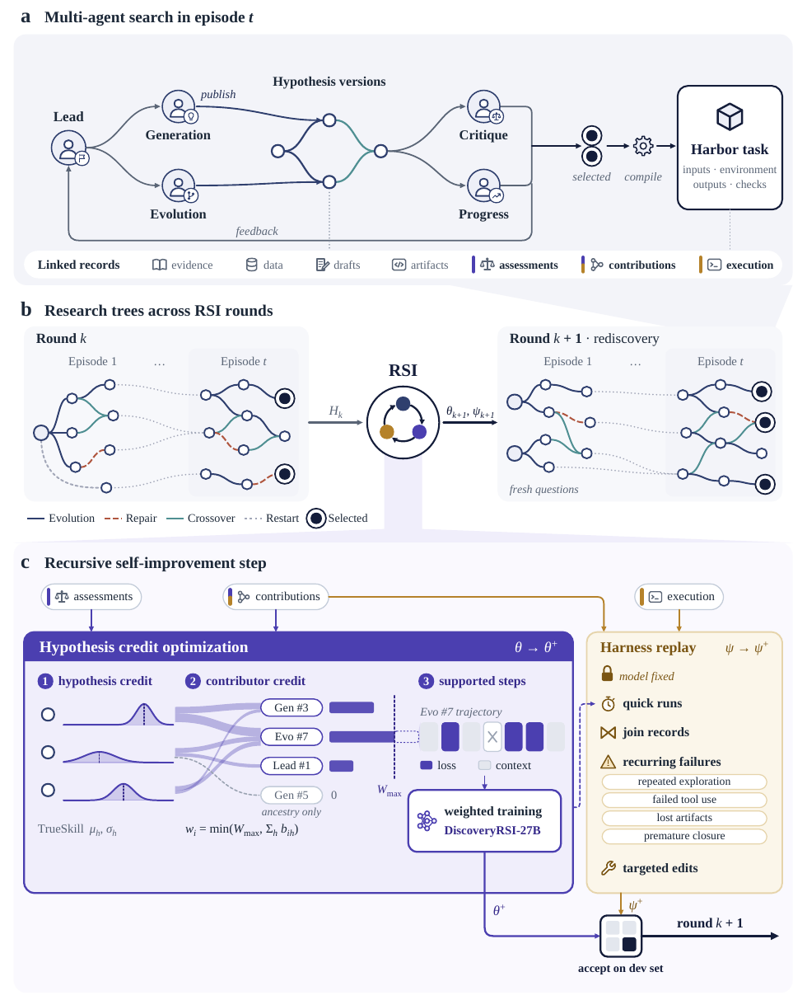
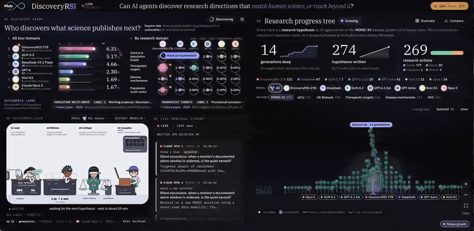

<div align="center">

<h1>DiscoveryRSI</h1>

<p><strong>Recursively learning to discover valuable hypotheses</strong></p>

<p>
  <a href="https://github.com/Gen-Verse/DiscoveryRSI"></a>
  <a href="https://huggingface.co/Gen-Verse/DiscoveryRSI-27B"></a>
  <a href="https://huggingface.co/collections/Gen-Verse/discoveryrsi"></a>
  <a href="https://foundry-arena.rsi-arena.workers.dev/arena"></a>
</p>

</div>

## 🧭 DiscoveryRSI at a glance

**1. A new paradigm for scientific discovery.** We introduce **DiscoveryRSI**, a hypothesis-centered framework that turns research into a recursive learning process. Each proposal is a versioned research object combining an evidence-grounded claim, an investigation plan, explicit decision criteria, and alternative explanations. Multi-agent evolutionary search develops a research graph, selected computational investigations are compiled into executable Harbor tasks, and the evidence, decisions, and artifacts behind each revision are preserved as reusable experience.

**2. A 27B model trained from research experience.** We introduce **DiscoveryRSI-27B**, trained with Hypothesis Credit Optimization: assessments of scientific quality are linked to documented contributions such as finding evidence, adding a comparator, clarifying a measurement, or repairing a falsification rule. In matched runs, DiscoveryRSI-27B selected **16.7% more unique hypotheses** and successfully compiled **50% more Harbor tasks** than its base model.

**3. DFM-Bench, a benchmark for cumulative research progress.** We introduce **DFM-Bench** to evaluate more than a single attractive final answer. It scores individual hypotheses, revisions against their actual predecessors, ordered development paths, complete research runs, and deduplicated scientific contributions. This separates a good proposal from a productive research process, and an executable package from a scientifically validated result.



*Figure 1. DiscoveryRSI couples multi-agent hypothesis development, contribution attribution, recursive model and workflow improvement, and process-level evaluation.*

## 📦 Resources

| **Type** | **Name** | **Link** |
| --- | --- | --- |
| 🤖 Model | **DiscoveryRSI-27B** | [🤗 Hugging Face](https://huggingface.co/Gen-Verse/DiscoveryRSI-27B) |
| 🧰 Code | **DiscoveryRSI harness** | [GitHub](https://github.com/Gen-Verse/DiscoveryRSI) |
| 📚 Collection | **DiscoveryRSI models** | [🤗 Hugging Face](https://huggingface.co/collections/Gen-Verse/discoveryrsi) |
| 📺 Demo | **DiscoveryRSI live arena** | [Open arena](https://foundry-arena.rsi-arena.workers.dev/arena) |
| 🧪 Benchmark | **DFM-Bench workflow evaluation** | [Explore the harness](https://github.com/Gen-Verse/DiscoveryRSI#evidence) |

## 🧠 What DiscoveryRSI does

The public harness includes the portable agentic core, provider adapters, role prompts, tool registry, replay store, campaign manifest, and domain adapters.

It supports research workflows that:

- generate falsifiable, data-aware study plans;
- add controls, measurements, alternatives, and evidence boundaries;
- preserve parent links and revision lineage;
- identify whether an idea was evolved, repaired, crossed over, or restarted;
- replay tool failures, repeated rediscovery, and lost context; and
- evaluate complete research paths instead of isolated text generations.

The system was developed across **clinical and population health, therapeutic-target prioritization, disease mechanisms, and population multi-omics**. 
## 📺 Watch the live research loop

PhAI Labs is running a technical livestream that shows a scientific agent move from an open question to a testable research plan, then learn from evidence, critique, and revision.

<p align="center">
  <a href="https://foundry-arena.rsi-arena.workers.dev/arena"></a>
</p>

**Click the animation to jump directly to the live website.** 

The arena makes the process inspectable: model comparisons, research domains, candidate hypotheses, compiled experiments, and the growing hypothesis tree update as the run progresses.


## 🚀 Quick Start

Clone the repository and install the public harness:

```bash
git clone https://github.com/Gen-Verse/DiscoveryRSI.git
cd DiscoveryRSI
python3 -m venv .venv
source .venv/bin/activate
python -m pip install -e .
```

Run the deterministic local demo and tests:

```bash
discovery-rsi demo --iterations 2
pytest
```

## 🤖 Connect DiscoveryRSI-27B

The released checkpoint is [`Gen-Verse/DiscoveryRSI-27B`](https://huggingface.co/Gen-Verse/DiscoveryRSI-27B). Serve it behind an OpenAI-compatible endpoint, then point the harness at that endpoint:

```bash
export MODEL_ID=Gen-Verse/DiscoveryRSI-27B
vllm serve "$MODEL_ID" --served-model-name discoveryrsi-27b
```

In a second terminal:

```bash
export DISCOVERY_RSI_BASE_URL=http://localhost:8000/v1
export DISCOVERY_RSI_MODEL=discoveryrsi-27b
export DISCOVERY_RSI_API_KEY=local

discovery-rsi campaign \
  --adapter openai-compatible \
  --manifest configs/research_manifest.json \
  --roles plugins/discovery-rsi/roles \
  --iterations 3 \
  --replay episodes.jsonl
```

The harness can also run with Codex, Claude Code, another OpenAI-compatible endpoint, or any implementation of the `ModelAdapter` protocol.

## 🧪 Research Domains

The public package includes workflows and adapters for:

- clinical and population health;
- therapeutic-target prioritization;
- disease mechanisms;
- population multi-omics; and
- GEO-derived pathway and target records.

Bring only data you are authorized to use. No patient rows, HCC material, UK Biobank material, private campaign traces, credentials, or laboratory infrastructure are bundled.

## ⚠️ Limitations and Responsible Use

DiscoveryRSI can produce plausible but unsupported claims, omit relevant evidence, misread sources, or propose infeasible experiments. Generated hypotheses require expert review, source checking, and independent verification. The system is not a medical device and must not be used to make clinical or other high-stakes decisions without qualified oversight.

## 📝 Citation

If you use DiscoveryRSI or DiscoveryRSI-27B, cite the technical report and link the released model:

```bibtex
@software{discoveryrsi,
  title = {DiscoveryRSI},
  url = {https://github.com/Gen-Verse/DiscoveryRSI},
  note = {Recursive scientific hypothesis discovery and DiscoveryRSI-27B}
}
```

- [Technical report and maintained citation links](https://github.com/Gen-Verse/DiscoveryRSI#citation)
- [DiscoveryRSI-27B model card](https://huggingface.co/Gen-Verse/DiscoveryRSI-27B)
- [PhAI Labs](https://phai-labs.com/)

## 📄 License

Project-owned code is licensed under Apache-2.0. See [LICENSE](LICENSE) and [THIRD_PARTY_NOTICES.md](THIRD_PARTY_NOTICES.md). The model license, base-model terms, and dataset attribution requirements are specified separately in the model card.
