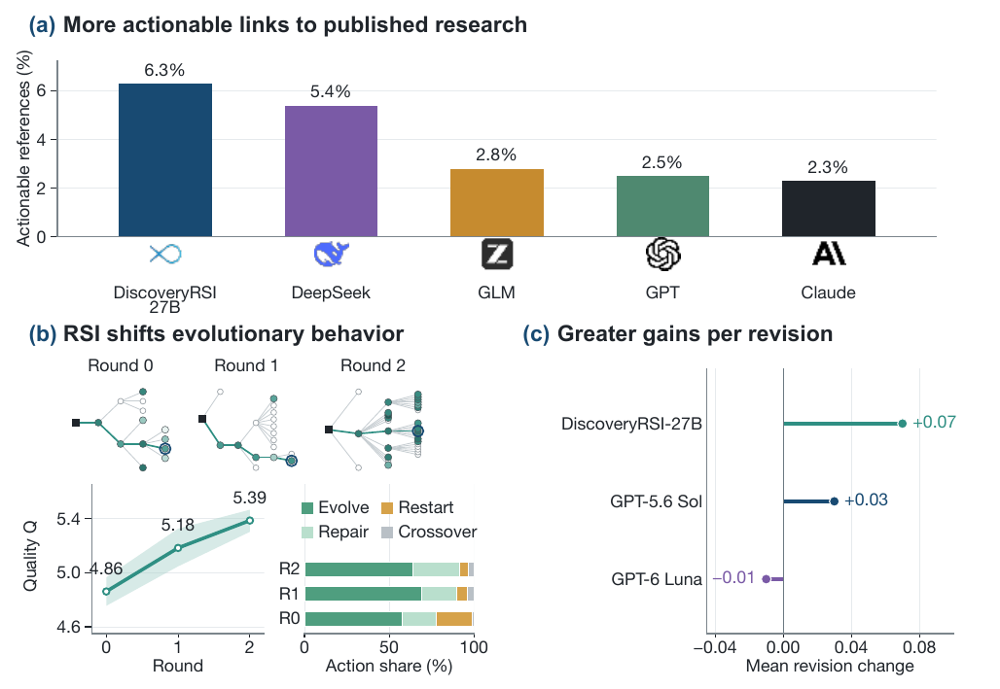

<h1 align="center">DiscoveryRSI</h1>

<p align="center">
  <strong>Recursively learning to discover valuable hypotheses</strong>
</p>

<p align="center">
  A research agent that turns evidence, criticism, and revision into a persistent scientific learning process.
</p>

<p align="center">
  <a href="https://github.com/Gen-Verse/DiscoveryRSI"></a>
  <a href="https://huggingface.co/collections/Gen-Verse/discoveryrsi"></a>
  <a href="https://foundry-arena.rsi-arena.workers.dev/arena"></a>
  <a href="https://phai-labs.com/"></a>
</p>

<p align="center">
  <a href="#overview">Overview</a> ·
  <a href="#how-discoveryrsi-learns">How it learns</a> ·
  <a href="#evidence">Evidence</a> ·
  <a href="#quick-start">Quick start</a> ·
  <a href="#data-and-model-access">Access</a> ·
  <a href="#citation">Citation</a>
</p>

## Overview

A useful research agent must do more than produce plausible text. It must decide which questions are worth pursuing, make the proposed test concrete, expose the assumptions that could make it fail, and use the result of criticism to improve the next version.

**DiscoveryRSI** is a framework for that process. It represents each research hypothesis together with its investigation plan, evidence, alternatives, decision criteria, and lineage. A multi-agent research tree then develops, repairs, combines, or restarts directions as evidence changes.

The central loop is:

**Explore → Evaluate → Revise → Attribute → Learn**

A hypothesis is not treated as a finished answer. It is a versioned research object whose value comes from the clarity of its claim, the quality of its proposed test, and the evidence that changes what the agent should do next.



*Figure 1. DiscoveryRSI result highlight from the technical report.*


*Figure 2. DiscoveryRSI method: hypothesis trees, contribution attribution, and recursive improvement.*

## How DiscoveryRSI learns

DiscoveryRSI makes the research process itself the source of learning.

- **Hypothesis development.** Agents preserve parent links while refining a question, repairing a weak design, combining complementary ideas, or restarting when the evidence demands it.
- **Hypothesis Credit Optimization.** A useful contribution can be attributed to the behavior that produced it: finding a key piece of evidence, adding a necessary comparator, clarifying a measurement, or repairing a falsification rule. These contributions become training signals for DiscoveryRSI-27B.
- **Harness Replay.** The harness replays failure modes such as repeated rediscovery, tool failure, and lost context. Workflow changes can then be tested while holding the model fixed.
- **DFM-Bench.** Evaluation extends beyond a single answer to the evolution of hypotheses, the research path, and the quality of the complete investigation process.

The public release contains the portable agentic core, the harness, provider adapters, role prompts, tool registry, replay store, and domain adapters. Private campaign traces, credentials, laboratory infrastructure, and restricted datasets are not included.

## Research domains

DiscoveryRSI was developed for life-science research questions spanning:

- clinical and population health;
- therapeutic-target prioritization;
- disease mechanisms; and
- population multi-omics.

The public package also includes adapters for **GEO-derived gene sets with Gene Ontology pathway annotations** and therapeutic-target prioritization. These adapters accept user-provided records and produce testable candidates with comparators, alternatives, evidence fields, and falsification criteria.

## Evidence

The technical report evaluates whether generated hypotheses can connect to useful future research. A shared literature reference set is searched using forward and backward citation expansion, with each model group evaluated using its own knowledge cutoff.

In the reported comparison, DiscoveryRSI reached a **6.3% reference-actionability rate**, approximately **2.5× the GPT group** and **2.7× Claude**. This measure asks whether a generated hypothesis can be linked to a concrete research direction in later expert-published work, such as an experimental comparison, a measurement strategy, or a testable evidence gap. It is a retrospective inspiration signal, not proof that a model’s hypothesis was adopted or validated.

The broader experiments study four questions:

1. whether repeated model improvement raises hypothesis quality and testability;
2. whether research behavior shifts toward developing and repairing ideas;
3. whether biomedical researchers judge revisions as useful; and
4. whether generated hypotheses connect to subsequent expert research.

## Quick start

Clone the repository and install the public agentic system:

```bash
git clone https://github.com/Gen-Verse/DiscoveryRSI.git
cd DiscoveryRSI
python3 -m venv .venv
source .venv/bin/activate
python -m pip install -e .
```

Run the local demonstration:

```bash
discovery-rsi demo --iterations 2
pytest
```

Run a provider-backed research campaign with your own API key:

```bash
export DISCOVERY_RSI_BASE_URL=https://api.openai.com/v1
export DISCOVERY_RSI_MODEL=gpt-4o-mini
export DISCOVERY_RSI_API_KEY=your-key
discovery-rsi campaign \
  --adapter openai-compatible \
  --manifest configs/research_manifest.json \
  --roles plugins/discovery-rsi/roles \
  --iterations 3 \
  --replay episodes.jsonl
```

Codex and Claude Code are supported through their native local CLIs:

```bash
# Codex
export DISCOVERY_RSI_CODEX_MODEL=gpt-6.1-sol
discovery-rsi campaign --adapter codex --manifest configs/research_manifest.json

# Claude Code
export ANTHROPIC_AUTH_TOKEN=your-token
export DISCOVERY_RSI_CLAUDE_MODEL=claude-sonnet
export DISCOVERY_RSI_PLUGIN_DIR=plugins/discovery-rsi
discovery-rsi campaign --adapter claude-code --manifest configs/research_manifest.json
```

## Data and model access

This repository contains the agentic system, not a clinical dataset. Bring data that you are authorized to use through a user-owned adapter, keep source files read-only, and record dataset versions and evidence provenance in the candidate records. No patient rows, HCC material, UK Biobank material, private campaign traces, or credentials are bundled.

For GEO-based work, prepare a legally accessible GEO series matrix or differential-expression table, map the relevant genes to Gene Ontology terms, and pass the resulting records to the public GEO adapters. The example JSON files are synthetic smoke tests.

The DiscoveryRSI-27B checkpoint is distributed separately through the [Gen-Verse Hugging Face collection](https://huggingface.co/collections/Gen-Verse/discoveryrsi) when access is enabled. The harness can also run with Codex, Claude Code, any OpenAI-compatible endpoint, or another implementation of the `ModelAdapter` protocol.

## Repository layout

```text
src/discovery_rsi/          core loop, harness, adapters, tools, and manifest
plugins/discovery-rsi/       public research roles and rubric
configs/                     portable campaign and GEO examples
docs/media/                  technical-report figures
tests/                       deterministic CPU checks
```

## Citation

If you use DiscoveryRSI, please cite the technical report and the released model card. The code and model links are maintained here:

- [GitHub repository](https://github.com/Gen-Verse/DiscoveryRSI)
- [Hugging Face collection](https://huggingface.co/collections/Gen-Verse/discoveryrsi)
- [PhAI Labs](https://phai-labs.com/)
- [DiscoveryRSI live stream](https://foundry-arena.rsi-arena.workers.dev/arena)

## License

Project-owned code is licensed under Apache-2.0. See [LICENSE](LICENSE) and [THIRD_PARTY_NOTICES.md](THIRD_PARTY_NOTICES.md).
