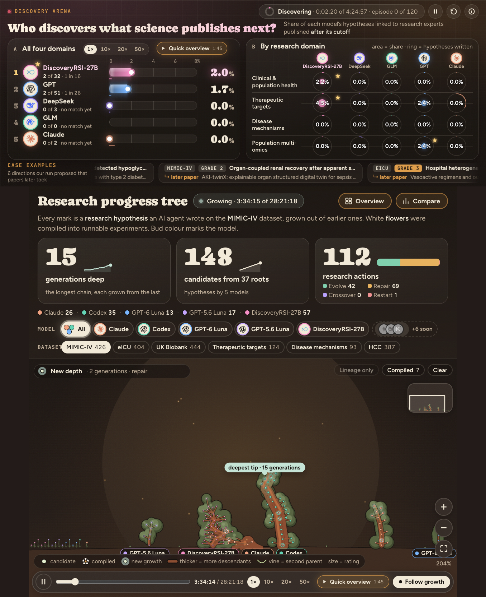

<h1 align="center">DiscoveryRSI</h1>

<p align="center">
  <strong>Recursive self-improvement for scientific discovery</strong>
</p>

<p align="center">
  DiscoveryRSI turns research questions, evidence, critique, and revision into a learning loop that compounds across investigations.
</p>

<p align="center">
  <a href="https://github.com/Gen-Verse/DiscoveryRSI"></a>
  <a href="https://huggingface.co/Gen-Verse/DiscoveryRSI-27B"></a>
  <a href="https://foundry-arena.rsi-arena.workers.dev/arena"></a>
  <a href="https://phai-labs.com/"></a>
</p>

<p align="center">
  <a href="#paradigm">Paradigm</a> ·
  <a href="#model">Model</a> ·
  <a href="#bench">Bench</a> ·
  <a href="#watch-the-live-arena">Watch live</a> ·
  <a href="#run">Run</a> ·
  <a href="#citation">Citation</a>
</p>

## Paradigm

A scientific agent should do more than generate plausible text. It should decide what is worth investigating, turn a question into a falsifiable plan, identify the evidence that could change the conclusion, and improve the next attempt when a design fails.

**DiscoveryRSI** makes that process the training signal. Each hypothesis is a versioned research object with a claim, test, evidence, alternatives, decision criteria, and lineage. Agents can develop, repair, combine, or restart directions while preserving the decisions that produced each revision.

The loop is:

**Question → Hypothesis → Evidence → Experiment → Revision → Learning**

Hypothesis Credit Optimization attributes progress to concrete research behavior: finding decisive evidence, adding a necessary comparator, clarifying a measurement, or repairing a falsification rule. Harness Replay tests workflow improvements under failure modes such as repeated rediscovery, tool failure, and lost context. Rediscovery carries evaluated improvements into the next research task.


*Hypothesis trees, contribution attribution, and recursive improvement.*

## Model

The released model is [`Gen-Verse/DiscoveryRSI-27B`](https://huggingface.co/Gen-Verse/DiscoveryRSI-27B). It is trained to improve research hypotheses and research decisions across rounds, while the public repository provides the agentic harness around it.

The harness is model-agnostic. You can run DiscoveryRSI-27B behind an OpenAI-compatible endpoint, or use Codex, Claude Code, or another implementation of the `ModelAdapter` protocol.

```bash
export MODEL_ID=Gen-Verse/DiscoveryRSI-27B
vllm serve "$MODEL_ID" --served-model-name discoveryrsi-27b
```

## Bench

**DFM-Bench** evaluates the research process, not only the final paragraph. It scores hypothesis revisions, complete research paths, evidence use, scientific judgment, and the final contribution of an investigation.

The experiments cover clinical and population health, therapeutic-target prioritization, disease mechanisms, and population multi-omics, with additional battery research tracks. In the reported comparison:

- DiscoveryRSI reached **6.3% reference-actionability**, about **2.5× GPT** and **2.7× Claude**.
- Two self-improvement rounds raised average hypothesis quality from **4.86 → 5.18 → 5.39**.
- Expert reviewers rated **41%** of DiscoveryRSI-27B revisions as improvements, **47%** as unchanged, and **12%** as regressions.
- In the battery track, **58.47%** of research evolutions were judged substantive progress.

Reference-actionability measures whether a generated hypothesis can be linked to a concrete direction in later expert-published research. It is an inspiration signal, not proof that an AI hypothesis was adopted or validated.

## Watch the live arena

> **The research loop is live.** Watch hypotheses evolve, evidence accumulate, experiments get compiled, and research trees grow across models and domains.
>
> [**Enter the DiscoveryRSI live arena →**](https://foundry-arena.rsi-arena.workers.dev/arena)

<a href="https://foundry-arena.rsi-arena.workers.dev/arena"></a>

## Run

Install the public harness:

```bash
git clone https://github.com/Gen-Verse/DiscoveryRSI.git
cd DiscoveryRSI
python3 -m venv .venv
source .venv/bin/activate
python -m pip install -e .
```

Run the deterministic local demo:

```bash
discovery-rsi demo --iterations 2
pytest
```

Run a campaign with DiscoveryRSI-27B served locally:

```bash
export DISCOVERY_RSI_BASE_URL=http://localhost:8000/v1
export DISCOVERY_RSI_MODEL=discoveryrsi-27b
export DISCOVERY_RSI_API_KEY=local

discovery-rsi campaign \\
  --adapter openai-compatible \\
  --manifest configs/research_manifest.json \\
  --roles plugins/discovery-rsi/roles \\
  --iterations 3 \\
  --replay episodes.jsonl
```

The repository contains the portable agentic core, harness, provider adapters, role prompts, tool registry, replay store, and domain adapters. Datasets, credentials, private campaign traces, and restricted laboratory infrastructure are not bundled.

## Citation

If you use DiscoveryRSI, please cite the technical report and the released model card:

- [GitHub repository](https://github.com/Gen-Verse/DiscoveryRSI)
- [DiscoveryRSI-27B on Hugging Face](https://huggingface.co/Gen-Verse/DiscoveryRSI-27B)
- [DFM-Bench and technical report](https://github.com/Gen-Verse/DiscoveryRSI#citation)
- [PhAI Labs](https://phai-labs.com/)
- [DiscoveryRSI live arena](https://foundry-arena.rsi-arena.workers.dev/arena)

## License

Project-owned code is licensed under Apache-2.0. See [LICENSE](LICENSE) and [THIRD_PARTY_NOTICES.md](THIRD_PARTY_NOTICES.md).
